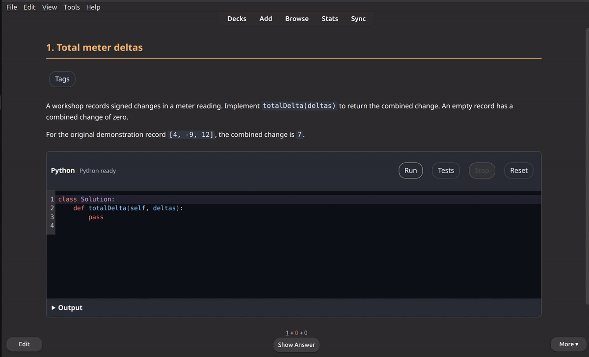

# AnkiCode

[](https://github.com/ronketer/anki-code-practice/actions/workflows/ci.yml)

AnkiCode turns Anki flashcards into coding exercises. Each card has a real code
editor (CodeMirror 6) and **Run** and **Tests** buttons that execute your solution
inside the card: Python through Pyodide, JavaScript natively, both in a sandboxed
Web Worker. Your draft survives flipping to the answer side, so you can compare
it with the reference solution and then grade yourself as usual. It is a
modernization of [krmanik/Anki-NeetCode](https://github.com/krmanik/Anki-NeetCode)
with a new editor, runtime and test generator.

<!-- Demo GIF placeholder. Record a card being solved in Anki (type, Run, Tests,
     Show Answer), save it as docs/demo.gif (under 2 MB), then replace the
     italic line below with:

-->
*Demo GIF coming soon.*

## Features

- **CodeMirror 6 editor** with Python and JavaScript highlighting, bracket
  matching, search and auto-indent. Follows Anki's night mode live.
- **Run and Tests in the card.** Ctrl/Cmd+Enter runs your code,
  Ctrl/Cmd+Shift+Enter runs the test suite. Results show `4/4 tests passed`
  and the first failing cases.
- **Sandboxed execution.** Code runs in a Web Worker with time limits (5 s for
  Run, 10 s for Tests), a Stop button and a 64 KB output cap, so an infinite
  loop never freezes Anki.
- **Generated test suites.** Write tests once as plain Python assertions. The
  builder turns them into a Python suite and an equivalent JavaScript suite,
  including order-insensitive checks for problems whose answers can come in any
  order.
- **Drafts that survive Show Answer** and reset on the next review, with
  fallbacks for WebViews that block `sessionStorage`.
- **Safe re-imports.** Notes have stable IDs, so importing an updated deck
  updates the cards and keeps your review history.

## Scope

This repository contains the card engine and a two-card demo built from one
original exercise. The full NeetCode 150 and Grind 169 decks I study with are
built from problem statements and datasets that can't be redistributed, so they
are not included. No LeetCode or NeetCode problem content is in this repository.

## Quick start

To just try it, download `AnkiCode-Demo.apkg` from the
[latest release](https://github.com/ronketer/anki-code-practice/releases/latest)
and import it into Anki with **File > Import**. To build it yourself:

Requirements: Python 3.13+ and [uv](https://docs.astral.sh/uv/). Building a
deck doesn't need Node.js, because the editor bundles are committed.

```bash
git clone https://github.com/ronketer/anki-code-practice.git
cd anki-code-practice
uv sync --locked
uv run python build_demo.py
```

This writes `build/demo/AnkiCode-Demo.apkg`. In Anki, choose **File > Import**
and pick that file. You get an **AnkiCode Demo** deck with a Python card and a
JavaScript card. Python cards download Pyodide (about 10 MB) from jsDelivr the
first time you press Run, so they need an internet connection.

To try the cards in a browser instead:

```bash
uv run python -m http.server 8879 --bind 127.0.0.1 --directory build/demo
```

Then open http://127.0.0.1:8879/.

## Project structure

```
build_demo.py            Builds the demo deck and browser preview pages
ankicode/
  test_generator.py      Python assertions -> self-reporting Python test suite
  js_harness.py          Same assertions -> JavaScript test harness
  apkg.py                Reads .apkg files for verification
card-template/
  front-pro.html         Python card templates (front, back) and shared CSS
  back-pro.html
  pro.css
  javascript/            JavaScript card templates, editor, runner and worker
  editor/                Python editor, runner and Pyodide worker; bundle build
  shared/                Card lifecycle and draft storage used by both languages
  js/, css/              Built bundles and vendored highlight.js / KaTeX assets
examples/cards.json      The original demo exercise (MIT licensed)
tests/                   Python and Node unit tests
tests/browser/           Playwright checks that drive the built demo cards
tools/                   Demo verification, Anki import check, publication audit
```

## How it works

**Card templates.** Anki renders the front template, which carries the note's
fields in hidden `<textarea>` elements. The builder HTML-escapes those fields,
so card content is read as plain text and never interpolated into JavaScript.
A small inline script loads the runtime bundle once per reviewer session.

**Editor and lifecycle.** `card-template/shared/practice-card.mjs` mounts a
CodeMirror 6 editor (bundled with Rollup from pinned packages), wires the
buttons and keyboard shortcuts, and saves the draft on every change. Anki reuses
one WebView for all cards, so a `MutationObserver` destroys the editor and worker
when the card is replaced and switches the editor theme when night mode changes.

**Workers.** Each language has a runner that creates a Web Worker from a
self-contained function, sends it the code, and terminates it on timeout, Stop or
card change. The Python worker loads Pyodide 0.29 once and reuses it. It runs
the card's prompt code, your code, then the generated `check()` function. If you
renamed the method the card expects, a `Solution` class with exactly one public
method is still graded. The JavaScript worker runs your code with the generated
harness in a strict-mode function and captures `console` output.

**Test generation.** Tests are written as
`assert candidate(args) == expected` with literal values only.
`ankicode/test_generator.py` validates them and produces a Python `check()`
that runs every case, deep-copies arguments and reports failures.
`ankicode/js_harness.py` emits the same cases as a JavaScript harness and
rejects values JavaScript can't represent exactly. Anything else raises an error
at build time instead of producing a suite that silently passes.

**Packaging.** `build_demo.py` uses [genanki](https://github.com/kerrickstaley/genanki)
with fixed model, deck and note IDs, and ships the license notices inside the
deck as media files.

## Running the tests

CI runs the unit tests, the demo build and verification, the publication audit
and a check that the committed bundles match their source on every push.

Unit tests (Python and Node):

```bash
uv run python -m unittest discover -s tests
node --test tests/
```

Build and inspect the demo deck, then run the publication audit:

```bash
uv run python build_demo.py
uv run python tools/verify_demo.py
uv run python tools/audit_publication.py
```

Browser checks drive the built demo cards in headless Chromium, using real
Pyodide and real workers. Playwright is installed into the ignored `build/`
folder, not into the project:

```bash
npm install --prefix build/browser-tools playwright
npx --prefix build/browser-tools playwright install chromium
node tools/verify_demo_browser.cjs
```

Import check against a real Anki installation. It uses a throwaway collection
and never opens your profile. Pass `--anki-package-dir` if Anki isn't in the
standard Windows or Linux location:

```bash
uv run python -B -S tools/verify_demo_import.py
```

### Rebuilding the editor bundles

Only needed after changing files in `card-template/editor`,
`card-template/javascript` or `card-template/shared`. Requires Node.js
(tested with v26):

```bash
npm ci --prefix card-template/editor --ignore-scripts
npm run build --prefix card-template/editor
npm run build --prefix card-template/javascript
```

The build regenerates `_cm6-LICENSES.txt` from the lockfile and fails on any
unresolved import.

## Credits

- [krmanik/Anki-NeetCode](https://github.com/krmanik/Anki-NeetCode) by Mani is
  the project AnkiCode started from: the idea of interactive NeetCode cards
  with an in-card Python runner, and the note fields. Its own lineage includes
  [Peng-YM/LeetCode-Anki](https://github.com/Peng-YM/LeetCode-Anki) and
  [krmanik/pycodeditor](https://github.com/krmanik/pycodeditor), both GPL-3.0.
  The editor, runtime, workers and test generator in this repository were
  rewritten.
- [CodeMirror 6](https://codemirror.net/) and Lezer by Marijn Haverbeke and
  contributors, plus the GitHub theme from
  [uiwjs/react-codemirror](https://github.com/uiwjs/react-codemirror) (MIT).
- [Pyodide](https://pyodide.org/) (MPL-2.0), loaded at runtime from jsDelivr.
- [highlight.js](https://highlightjs.org/) (BSD-3-Clause) and
  [KaTeX](https://katex.org/) stylesheets (MIT).
- [anki-persistence](https://github.com/SimonLammer/anki-persistence) (MIT),
  whose storage approach the draft keys stay compatible with.
- [genanki](https://github.com/kerrickstaley/genanki) (MIT) for building decks.

Full notices: [THIRD_PARTY_NOTICES.md](THIRD_PARTY_NOTICES.md).

AnkiCode is not affiliated with Anki, LeetCode or NeetCode.

## License

Copyright (C) 2026 ronketer. Licensed under [GPL-3.0](LICENSE). The demo exercise in `examples/` is
[MIT](examples/LICENSE). Bundled third-party components keep their own licenses,
listed in [THIRD_PARTY_NOTICES.md](THIRD_PARTY_NOTICES.md).
